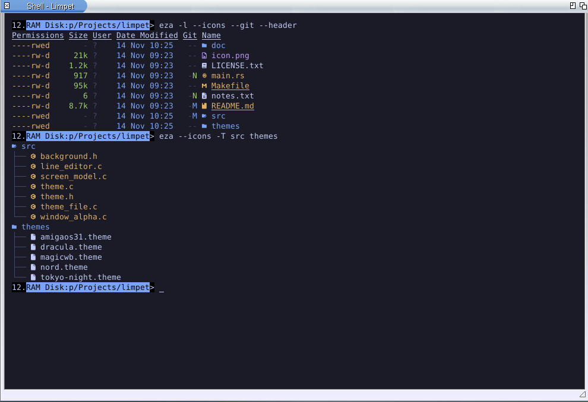

# eza for AROS

A native AROS build of [eza](https://github.com/eza-community/eza) 0.23.5, a
modern replacement for `List` and `Dir`: colours, file-type icons, a tree
view and Git status for local repositories.



eza 0.23.5 in [Limpet](https://tomaszstaniak.github.io/limpet/) 0.10.1 on AROS One.

## Download

[Release 0.23.5-r3](https://github.com/tomaszstaniak/aros-eza/releases/tag/v0.23.5-r3):

| System | Archive |
| --- | --- |
| AROS One and other ABIv11 systems, x86_64 | `Eza-0.23.5-r3-aros-x86_64-abiv11-pc.zip` |
| mainline AROS (ABIv1), x86_64, nightly 2026-11-24 or later | `Eza-0.23.5-r3-aros-x86_64-abiv1-pc.zip` |
| native AROS on the Raspberry Pi (ABIv1, AArch64), nightly 2026-11-24 or later | `Eza-0.23.5-r3-aros-aarch64-abiv1-raspi.zip` |

For mainline and Pi nightly builds before 2026-11-24, use
[release 0.23.5-r1](https://github.com/tomaszstaniak/aros-eza/releases/tag/v0.23.5-r1).

In Limpet 0.14.0 or later, TAB completes eza's options and their values
(`eza --so`, TAB: `--sort`). The package brings the list in
`Completions/eza`.

With [apkg](https://github.com/tomaszstaniak/arospkg): `apkg install eza`.

By hand: unpack the archive into any drawer and add the `Eza` drawer to the
Shell's search path, for example `Path Work:Eza ADD` in `S:User-Startup`.

## Use

```
eza -l --icons --git --header
eza -T -L2 Work:
eza -1 --sort=size SYS:C
eza -l --time-style=long-iso SYS:
```

eza needs a console that reports its capabilities: at least 256 colours and
its size. Limpet 0.7.0 or later does, and also shows the icons and file
links. In the standard Shell window (`CON:`) a listing is refused with return
code 5; help and `--version` work everywhere. Output sent to a file or a pipe
is plain text, also with `--color=always`.

- Git status (`--git`, `--git-repos`, `--git-ignore`) reads local
  repositories through a built-in libgit2, also at the root of a volume. No
  git program is needed; remote operations are not available.
- Icons (`--icons`) and file links (`--hyperlink`) are shown only when the
  console reports that it can show them. Limpet shows the icons with its own
  font at the default size of 13 pixels.
- Permissions are the AmigaDOS bits **hsparwed**, not Unix rwx. Owner and
  group show `?` where the filesystem records none.
- POSIX operands `./x` and `../x` work when no file has that literal name.
- On AROS One a Shell pipeline (`eza | other`) needs `Set _mchar @@` first:
  its `C:Pipe` drops the command line when `_mchar` is empty.

Known limitations: AROS One's default text tool (JanoEditor) opens an empty
document for a name containing `#`. Unix-specific options (owners, extended
attributes, mount points) and symbolic-link semantics are outside what was
checked on AROS.

## Source

[Build](docs/development.md) and [patch workflow](docs/patching.md). The
upstream pin is in [upstreams.json](upstreams.json), the AROS changes are the
series in `patches/eza`. Each archive holds the modified source, the patches
and its build record.

eza is under the EUPL 1.2; see [LICENSE.txt](LICENSE.txt). Copyright
Christina Sørensen, eza contributors, Benjamin Sago and the other copyright
holders named in the source.
